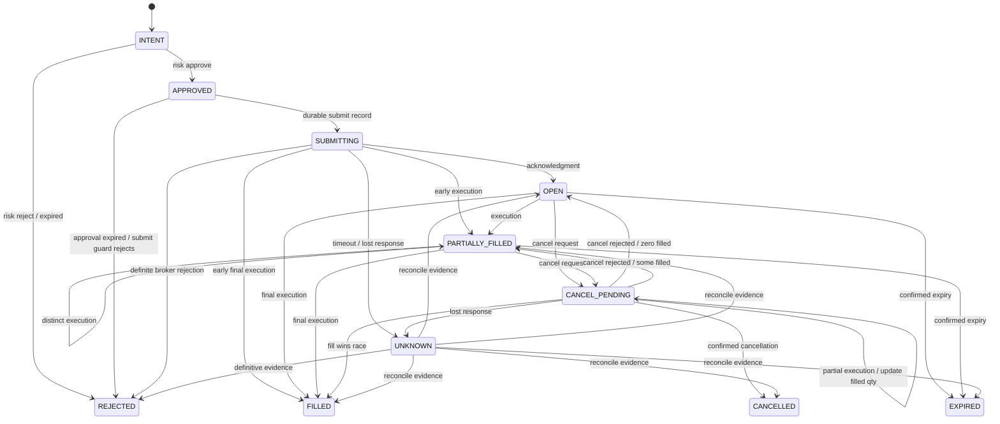

# Trgovački događaji i životni ciklus

Normativni dizajn TAI-005; provedba state machinea je TAI-043.
Izvor: [PROJECT_SPEC.md](../PROJECT_SPEC.md), [režimi](MODES.md).

## Zajednička omotnica

Svaki nepromjenjivi event ima `schema_version`, `event_id` (UUID), `event_type`,
`occurred_at` (izvorni UTC trenutak), `received_at`, `usable_at` kada relevantno,
`correlation_id` (cijela odluka), `causation_id` (prethodni event), `idempotency_key`,
`mode`, `account_id`, `instrument_id`, `producer`, `payload`. `order_id` i
`broker_event_id` obvezni su kada postoje. Decimal iznosi su JSON stringovi.
Schema version nepoznata consumeru ide u quarantine bez financijskog efekta.

Signal može imati više intentova; svaki intent ima vlastiti idempotency key i
order identity. Correlation nije dedupe ključ. Ponovna dostava ima isti event_id;
isti ključ s drugačijim sadržajem jest konflikt, ne novi nalog.

## Vrste događaja

| Event | Obvezni sadržaj / značenje |
| --- | --- |
| signal | strategy/version, dataset snapshot, feature cutoff/usable_at, score i razlog; ne daje dozvolu trgovanja |
| intent | strana BUY/SELL, qty, order type, limit ako postoji, expiry, mode, account, strategy, idempotency key |
| risk_decision | intent hash, policy version, APPROVE/REJECT, reasons, exposure snapshot, expiry; vezano uz točno taj intent |
| submit | order_id, odobreni intent hash, adapter, attempt identity; zapisati prije slanja, bez tajni |
| acknowledgment | broker order ID, prihvaćena qty, izvorni status i timestamp; nije fill |
| partial_fill | jedinstveni execution ID, qty, price, fee/currency, cumulative qty; ledger knjiži samo novi delta |
| fill | execution ID, final cumulative qty, price, fee/currency; završena količina, ne pretpostavka primitka acknowledgmenta |
| cancel | request/result, cancel identity, remaining qty, razlog; request nije potvrda otkaza |
| reconcile | promatrani broker/local status, as_of, discrepancy, evidence IDs, resolution ili unresolved |

## Stanja naloga

REJECTED, CANCELLED, FILLED i EXPIRED su terminalni za operativni lifecycle.
Kasni broker execution nakon otkaza nije izgubljen: provjeriti execution identity,
knjižiti točan dotad nepoznat fill i otvoriti reconciliation incident; ne raditi
novi submit. Terminalni status ne briše stvarni financijski događaj. Cancel s
partial fillom znači otkazan samo preostali dio, bez povrata potrošenog casha.

## Zabranjeni prijelazi i invarijante

- INTENT -> SUBMITTING bez važeće risk odluke nikad nije dopušten.
- REJECTED/CANCELLED/FILLED/EXPIRED -> SUBMITTING nije retry put; novi intent zahtijeva novu odluku.
- UNKNOWN -> SUBMITTING je zabranjeno; samo read reconciliation razrješava ishod.
- Acknowledgment nakon FILLED ne smije vratiti stanje u OPEN.
- `sum(unique fill qty) <= accepted order qty`; prekoračenje se evidentira kao incident i HALT, ne prikriva.
- Cumulative qty nikad se ne smanjuje. Out-of-order poruke usporediti s dokazima, ne s vremenom primitka.
- Duplikat execution ID-a ne knjiži ništa; isti ID s različitim payloadom pokreće incident.
- Svaki ledger efekt i event-consumption marker moraju biti u istoj DB transakciji.
- UNKNOWN po accountu blokira nove submitove dok account nije reconciled.

## Primjeri budućih provjera

Izgubljen odgovor nakon createa: SUBMITTING -> UNKNOWN -> read lookup -> OPEN,
bez drugog createa. Dupli fill: jedna ledger transakcija. Fill tijekom cancela:
CANCEL_PENDING -> FILLED, bez oslobađanja već potrošenog casha. Nepoznat broker
status: quarantine + HALT, bez pretpostavke REJECTED.
